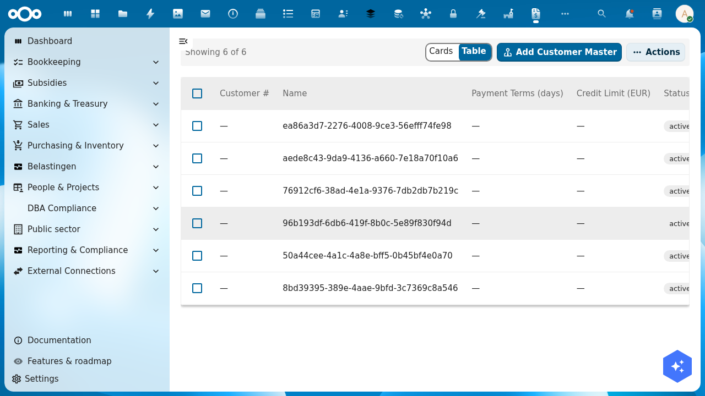

# Customers

The **Customers** page shows all customers (*debiteuren* / *klanten*) you have invoiced in Shillinq. Like vendors, customer records are **Nextcloud Contacts** enriched with financial details such as payment terms and Peppol addresses.

## How customer data works

When you create an invoice and select a customer, Shillinq:
1. Looks up the contact in Nextcloud Contacts.
2. Stores Shillinq-specific settings (payment terms, Peppol ID, invoice number prefix) alongside the contact.
3. Uses the contact's name, address, and VAT number on generated invoices and credit notes.

Manage contact details (name, address) in Nextcloud Contacts. Manage financial settings (payment terms, e-invoicing setup) in Shillinq.

## Add a customer

Customers are created implicitly when you first invoice a contact. To pre-configure a customer's financial settings before their first invoice:

1. Go to **Bookkeeping → Customers**.
2. Click **+ Add customer**.
3. Search for and select a Nextcloud Contact.
4. Configure:
   - `paymentTerms` — default number of days to pay (e.g. 30)
   - `defaultGlAccount` — the revenue account to pre-fill on new invoices (e.g. `80000` for professional services)
   - `currency` — default currency for invoices to this customer
   - `vatNumber` — customer's VAT number (required for intra-EU zero-rate invoicing)
   - `peppolId` — Peppol receiver ID (for Dutch government and Peppol-registered customers)
   - `invoiceDelivery` — preferred delivery method: email, Peppol, or manual download
5. Save.

## Look a company up in the KvK

The **KvK number** field of a customer is looked up in the KvK Handelsregister (the Dutch chamber of commerce register):

1. Type a company name or a KvK number in **KvK number**.
2. Pick the company from the list.
3. The **legal name** and the **trade name** fill in.

The lookup only fills fields that are still empty. When you already typed a name, you are asked before it is replaced. What fills in is a copy: when the company later changes its name in the KvK, the customer and its invoices keep the name they were saved with.

The lookup needs the KvK source to be linked. Until an administrator links it in Integriq (**External connections → KvK Handelsregister**), the field is a plain text field: type the number and save, and the form says the KvK lookup is not set up.

## Customer balance

Click any customer row to open their detail view. The **Balance** tab shows:
- Total invoices sent (lifetime)
- Currently outstanding invoices (open receivables)
- Average payment duration (how many days on average this customer pays)
- Oldest open invoice (helps you decide when to start a dunning process)

## Dunning (payment reminders)

When a customer is overdue, Shillinq can send payment reminders automatically. Configure the reminder schedule in **Settings → Dunning ladders** and assign a ladder to the customer on their detail page.

## Related

- [Create an invoice](../../guides/create-invoices.md) — send a customer invoice
- [Accounts Receivable](../../guides/create-invoices.md) — the full AR workflow
- [Bank Reconciliation](../../guides/import-bank-statements.md) — match received payments to invoices
