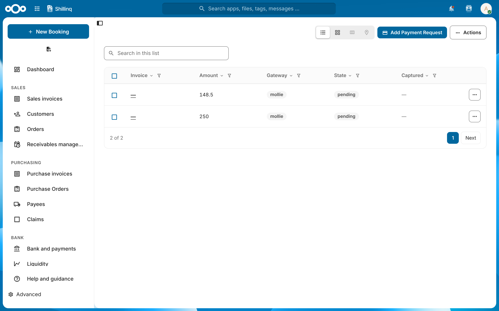
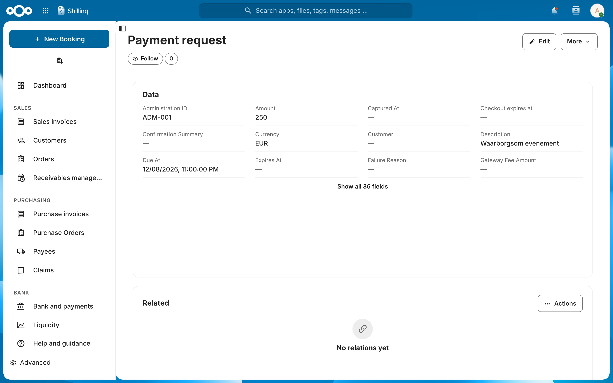
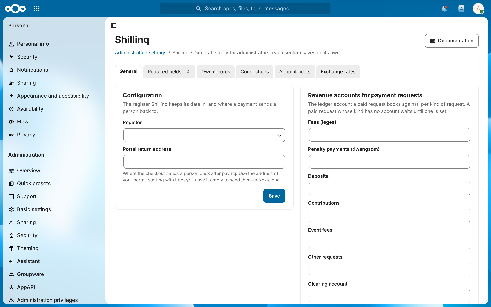

# Payment requests on a case

A payment request asks someone to pay for something that is not an invoice: fees (leges) on a permit application, a deposit for an event, a penalty payment. The request belongs to the record it is about, usually a case in Dossiq. Shillinq holds the request, sends the payment link and books the money when it arrives.

## Raise a request

A request is raised from the record itself. On a Dossiq case the payment requests panel lists the case's requests, with the published fee for the case when there is one. Other apps raise requests the same way through the `shillinq-payment-requests` leaf (see the [payment request leaf](../../api/payment-request-leaf.md) for developers).

You give the amount, the kind of request (fees, penalty payment, deposit, contribution, event fee or other), a description, the debtor and a due date. A record has at most one open request of each kind: a second pending fee request on the same case is refused.

Raising a request needs the `payment.request` action. Administrators carry it; your administrator maps it to groups.

## Follow requests in Shillinq

The **Payment requests** page lists the requests of the administration you work in, with their amount, payment provider and state.

Open a request to see its details: the amount and currency, the description, the due date, the payment link and when it expires, and when the money was captured.

## Send the link

**Send payment link**, on the request's page or in the panel on the case, mails the checkout link to the debtor. A request without a debtor email address, or without a link (anything that is no longer pending), is not sent; you get the reason instead.

## Record a payment made another way

When someone pays at the counter in cash or by pin, by bank transfer, or the fee is waived, choose **Mark paid by other means** in the panel on the case: how the money arrived (pin or cash at the counter, bank transfer, waived, or another way) and the reference the bank statement will show, then **Record the payment**. The whole requested amount is recorded. A waiver needs a reason.

The record is added next to whatever the payment provider reports. If a provider payment still arrives afterwards, the request reports an overpayment, so the refund is not forgotten.

Settling needs the `payment.administer` action.

## Choose the revenue accounts

A paid request books against a ledger account that depends on its kind. Set them under **Administration settings → Shillinq → General → Revenue accounts for payment requests**: one account per kind, plus a clearing account. A paid request whose kind has no account is kept as captured but unapplied until you set one.

